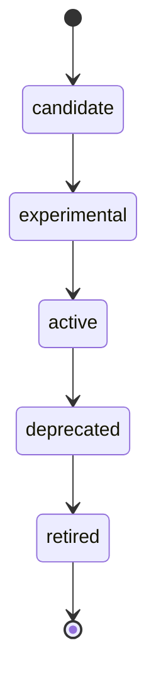

# Adaptive Engineering

The executable is `ae`, distributed as `ae-harness`. `@engineer` and `/engineer` remain the entry points. Fresh state uses `~/.ae`; existing populated `~/.harness` homes are discovered in place. An explicit `ae migrate --from-home <old-home> --ae-home <new-home>` copies the complete state with the original retained as backup. See [the migration guide](migration/ae.md) before switching homes or renaming a remote.

You start with two parts. The Engineer decides what to do. The Harness checks the work and keeps the record.

The Engineer is the only entry. It answers a question, investigates a system, delivers a change, or reviews a result. The Harness orients the work, locks a plan, gates edits, runs the named checks, and stores the evidence. A change is done when current verification passes, required review results are collected, and Harness records completion.

The Engineer grows the way a working engineer does. A repeated procedure becomes a skill. A judgment that needs its own reviewer becomes an agent. A rule for one kind of file becomes an instruction. A solved problem becomes a learning. None of these are required on the first day. The Engineer acquires them when the work shows they are needed. Installing the Harness does not require the specialist agents or the domain skills that may already be in this repository.

Plans for a product repository live in `~/.ae/projects/<repo-id>/plans/`. `--ae-home <path>` uses that directory instead of `~/.ae` for one command. `AE_HOME` does the same for every command. The flag wins. The knowledge search index for that repository lives at `index/<repo-id>/knowledge/` under the same root. Private solution episodes live in `~/.ae/projects/<repo-id>/docs/solutions/`. A reset of the product repository does not delete them. `ae migrate` copies existing plans, solutions, and `knowledge/solutions` into that store. Files already committed in the repository stay there until you remove them.

After `ae verify` passes, compounding records what the task taught. A detail that matters only for this task stays on the plan. A fact worth seeing again becomes a solution episode. A new skill or agent is a proposal. A person approves it before it is installed.

```bash
npm install -g ae-harness
ae install --configure-vscode
```

On an existing repository that has no spec or ADR yet, seed the workspace and the starter docs:

```bash
ae init-repo
ae prepare
```

`ae prepare` writes `docs/specs/overview.md` and `docs/adr/0000-architecture.md` when those paths are missing. Edit them. A later run leaves an existing file alone. Orient lists them as `intentSources`. Plan lock hashes them. If `docs/` is gitignored, prepare writes nothing and orient says to un-ignore those paths. Prepare does not rewrite a spec from the code.

Then select `@engineer` in Copilot Chat.

Windows checkouts use one canonical repository ID across long paths, short aliases, casing, and linked worktrees. Existing local storage under a known older spelling remains discoverable. Run `ae knowledge migrate-store` from that spelling to bind it permanently. If the old spelling is unavailable, run `ae knowledge migrate-store --from-id local-<12 hex digits>`. The command preserves knowledge, plans, and their absolute references in place. It refuses a non-empty canonical destination, unsafe paths, and replacement of an existing binding. The CLI and installed hooks share the project-layout resolver.

## How a task runs

Task modes are Answer, Investigate, Deliver, and Review. The Engineer owns the decision. The Harness owns the gate.

Deliver is host-first. The Engineer works in the editor. Kernel-always means orient, plan lock, gate, and verify run in the Harness even when no extra agent is loaded. Orient names in-repo specs as `intentSources` and whether the checkout is isolated. The implement gate fails when those specs are missing from plan `intent_sources`, or when issue work is still on the default branch of the primary checkout. `ae worktree --slug` opens a linked worktree. A plan that exists only as an uncommitted `docs/plans` file or a gitignored `.harness/plans` file is copied into the project store. A later worktree run replaces that copy when the checkout file is newer and no plan-update holds the file, and leaves the store copy when the store file is newer. A worktree with no `origin` remote shares that store, so the same `--plan` still resolves. A checkout created with `git init --separate-git-dir` keeps its own store. `.gitignore` is not followed when it is a symlink. Orient and `plan-new` share one selection for the same text. A non-empty `intent_sources` list is frozen. The implement gate requires those paths and does not rank again. An empty list in a repo that has a spec still fails and names the selection. Plan lock records `{ path, sha256 }` of the file bytes for each readable in-checkout `intent_sources` file on that tip. A symlink or a missing file fails the lock instead of hashing something outside the checkout or saving a path with no hash. `ae prepare` publishes a missing starter with an exclusive create, so a file that appears during the write is left as it is. Under content-v1, a later edit to a selected source invalidates its gate and proof until an explicit amendment accepts the reviewed bytes. Harness records old/new hashes, rationale, declared authority scope, and affected evidence. A relock preserves the frozen selection and cannot silently rehash it. Legacy plans retain their paths-only guarantee until deliberately migrated. If shipped behavior contradicts a locked spec, update that spec in the same PR or a stacked PR. Do not rewrite the spec from the code in silence. Ambiguous specs become `needs-info` questions, not guesses. Agent-optional means a specialist is consulted only when the task needs that judgment. Benchmark-test-only means the unattended agent loop is for a measured eval, not for normal delivery.

The runtime has four postures. Standalone is the Engineer with the Harness and no acquired specialist. Degraded is a missing check or index, reported rather than invented. Governed is a learning that a person has confirmed. Bounded delegation means a specialist receives a narrow question and does not take over the delivery.

## Optional headless delivery

The optional headless Deliver loop uses the same mutation hooks and completion authority. It requires `orient --read --query` with touched files before product edits and checks bound completion when the model tries to finish. Its lifecycle tool accepts authored decisions for planning, review assembly and compounding. A failed or missing proof cannot become a successful final message. The separate autonomous profile keeps its task-verifier contract and does not acquire the Deliver lifecycle.

Orient shows trust, constraints, acceptance criteria, review coverage and an implement-only gate preview. With no explicit file list it derives the change neighborhood from the selected plan scope. The compact pack removes repeated plan paths and optional prose before the work contract; an oversized contract creates an explicit context-read barrier. `orient --read --plan <path>` returns the contract and neighborhood without pack truncation. Finalize eval check and routing files before the person approval that pins them. An agent edit of pinned policy invalidates that approval.

## Product verification recipes

Orient returns bounded verification paths and coverage metadata. It prefers an explicitly selected recipe on the accepted plan, otherwise the sole existing `.cursor/skills/verify-*/SKILL.md`, otherwise `docs/verification/SKILL.md`. Several candidates produce an ambiguity result. Enumeration that reaches its bound reports an incomplete inventory and requires explicit selection. The Engineer reads the selected recipe before using it. A returned path does not prove a read or native editor registration. An extra `docs/features/` directory is reported and preserved.

Missing recipes are created only as scoped Deliver work with a locked plan and successful implement gate. Installation does not write product recipes. The existing `create-primitive` skill owns the creation and upkeep procedure in `references/product-verification.md`. The recipe has Launch, Doctor, Drive, Evidence, Cleanup, and Helpers sections. Its map has `features/README.md` and one file per feature with Sub-features, How a person reaches it, Driving it, and Gotchas sections. The initial top-three seed reports partial coverage.

For an ordinary visible change, the Engineer selects affected features and shared prerequisites, records the rationale, and updates the matching map in the same work. Their named drives become required acceptance checks. A requested full audit reads source and drives every mapped feature. A broad authentication, route, or runtime change can justify full coverage with an explicit rationale. Audit edits stay inside the verification directory. Missing external check registration or product defects remain scoped prerequisite gaps.

Each drive proves a real user path through readiness, doctor, action, observation, evidence, and cleanup. Doctor runs before the first drive and after a failed drive. Helpers clean up only resources they own and preserve artifacts after success, failure, or cancellation. An unreachable feature records its prerequisite and attempted route. A product assertion cannot be rewritten as intentional without an accepted intent amendment. Local CLI proof, installed-package proof, and native editor activation carry separate evidence.

## How capability is acquired

A capability moves through candidate, experimental, active, deprecated, and retired. Promotion needs a trigger eval, an outcome eval, and promotion evidence. Retirement leaves a tombstone so a later task can see the overlap with what replaced it.



A person can promote a learning. The governance ledger records that decision. The Engineer does not install a new skill or agent on its own.

## What a plan must contain

A new ordinary full delivery plan uses `plan_schema: 2`; a new short plan uses `short-v2`. Both declare `intent_source_policy: content-v1`. Domain parents and children use full `plan_schema: 3` records with the `.hplan` extension. Short plans do not acquire domain authority. Verification names trusted checks and maps each criterion to proof. Required review coverage remains explicit. Without an accepted named check the plan stays an unlocked draft. Legacy `plan_schema: 1` and `short-v1` remain readable with their declared paths-only source guarantee until explicit migration.

```yaml
plan_schema: 2
intent_source_policy: content-v1
intent_sources: []
verification:
  required: [behavior]
  criteria: {AC1: [behavior]}
reviews:
  required: [code-review]
  completed: []
  critical_open: []
```

Product plans list `code-review` in `reviews.required`. A docs plan may leave that list empty. `ae review prepare --plan <path> --base <base> --json` captures the work to review. The host invokes reviewers, then `ae review assemble --plan <path> --packet <id> --file <results.json> --json` validates and stores their results. Reviewer names are declared provenance; they do not authenticate an invocation. `ae verify` fails while collected review coverage is incomplete or critical findings remain. A bare completed string is not review evidence.

The Engineer runs review preparation and assembly. The coordinator receives the prepared packet, dispatches its required judgments, and returns raw results with their actual status. It has no terminal execution authority. Focused TDD checks run during implementation. Required review and authoritative `ae verify` follow the completed change. README edits use a proportional full docs plan and the same gate, proof, learning, and completion authority.

Document review accepts regular Markdown files from the current project's external plan store, including unlocked drafts. Each packet binds the exact absolute path and source hash. Explicit files in a standalone document review use `selected-document-v1` scope, binding only the selected regular sources, governing policy and trust, document criteria, and findings schema. The packet deliberately has no product diff, and findings must name a captured source. Preparation and assembly recheck source and governing-input freshness; assembly rederives the current project store and rejects changed, missing, symlinked, or unrelated sources. Plan-bound reviews and document reviews without explicit files retain broad product scope, as do existing untagged packets. Selected document review cannot satisfy delivery review obligations. A valid draft or collected review does not accept the plan or authorize implementation. Accepted plan changes use revision-bound decisions.

Supply semantic creation and amendment inputs through `ae plan-new --file` and `ae plan-update --file`. Harness owns headings, dates, criterion/task IDs, source bindings, progress, counts, and activity. A start decision validates readiness and scope, locks the resulting state, and binds the implement gate as one recoverable operation. Repeated operation IDs reuse the same accepted result; different payloads or stale revisions conflict. Author reasoning through note fields rather than constructing plan templates. See the shipped `skills/references/plan-operations.md` contract.

Full creation decisions accept `skillsUsed` for skills actually loaded. Primitive maintenance requires a `create-primitive` declaration. The declaration does not replace the successful skill read recorded for the current session. Decision inputs belong under `.harness/decisions/`; Harness owns the other lifecycle state files.

After verification, submit a publish or no-learning decision with `ae compound --plan <path> --learning-decision <file> --json`, then a complete plan-update decision. Completion version 2 requires a finished learning decision for current proof and completed tasks across all phases. Missing, pending, blocked, changed, or stale learning records prevent completion. No-learning creates no episode. The Stop hook validates current bound completion on every attempt. Progress and other bookkeeping do not change the work contract. Goal, criteria, scope, check mappings, policy, product bytes, selected intent bytes under content-v1, and execution phase still invalidate relevant evidence.

Captures and standalone index rebuilds share a lock on the physical knowledge manifest. A capture holds it through episode publication, retrieval snapshots, index rebuilding, and any rollback. Concurrent captures cannot replace a sibling's newer index or restore a snapshot over a successful sibling publication. Dry runs acquire no lock and write nothing.

Ordinary evidence uses version 5. Domain evidence uses version 6 to bind shared authority, participating revisions, child completion, and joint proof. Old proof requires re-verification when its format cannot enforce the current contract. Upgrade the CLI, corpus, and installed hooks together. Verification observations, review packets, learning operations, and completion records remain under `.harness/`. A lost final status write is recoverable by retrying the completion command.

Installed hooks resolve the hydrated CLI directly under `~/.copilot/.ae-bin/`. A global PATH entry is optional. Episode writers publish complete bytes atomically with exclusive creation; interruption before publication leaves the final name absent, and replay reuses an identical published episode. Review records enforce the same 1 MiB limit at write and read boundaries before changing the current coverage pointer.

`ae status --effective-policy --json` reports the CLI policy authority, rule-specific modes, positive freshness limits, trust binding, and resolver version. Installed hooks refresh that snapshot when source bytes, trust, or environment change. An unavailable or invalid authority fails closed. A command override is scoped to its invocation and is never cached as a hook policy.

Named checks are argv arrays in `.github/harness/checks.yaml`. The Harness runs them without a shell. Policy exemptions and waivers are explicit. A missing check is not a pass.

A named check may declare an `artifacts` list of explicit relative JSON filenames. The runner supplies a unique invocation directory under `.harness/evidence/check-artifacts/` through `HARNESS_CHECK_ARTIFACT_DIR`. It accepts at most 16 JSON objects of at most 1 MiB each, then stores redacted bytes and records their paths, byte lengths, and SHA-256 hashes. Missing output, malformed JSON, unsafe paths, symlinks, and nonregular files fail the check. Evidence validation rereads required artifacts and rejects changed or missing bytes. Concurrent invocations cannot overwrite one shared latest file. Artifact presence never replaces the helper's behavioral assertion and exit result. Checks without declarations retain their existing output guarantee.

Terminal hooks recognize a bounded set of read commands and explicit writes. Scripts, inline runtimes, package commands and ambiguous shell syntax are opaque. Opaque execution requires a fresh implement gate, current project trust and exact argv agreement with a required named check in the locked plan. Wrappers, command expansion and extra invocations cannot inherit that permission. This policy checks declared commands; it does not inspect script behavior or sandbox the process. Any potentially mutating terminal attempt leaves verification pending, including a failed command that may already have written files. Decision inputs have a contained, nonsymlink exception under `.harness/decisions/`; other lifecycle files remain guarded.

A standalone canonical `ae worktree --slug` can establish isolation before an implement gate, including recovery after a failed gate. Its CLI validation remains authoritative; wrappers, redirection and mixed commands retain their normal gate requirements. Bootstrap disables Git hooks and filesystem monitors, creates the worktree without checking out files, then resolves filter configuration in that checkout before populating raw committed bytes. This also suppresses filters enabled only by the target branch or Git directory. Unreadable helper metadata fails closed; a newly created checkout that cannot be populated is removed so a retry cannot accept an empty worktree. Configured filters, including Git LFS, do not run during bootstrap, so their committed pointer files remain raw. Ripgrep queries with `RIPGREP_CONFIG_PATH` set are opaque unless the first argument is `--no-config`, which unambiguously disables that configuration. Option text used as a pattern or filename grants no exemption. Explicit `--pre` or `--hostname-bin` options remain opaque even with `--no-config`.

Git query admission checks effective helper configuration through an uncached, bounded metadata read. Executable or unresolved query effects remain opaque. Authoritative product diffs and scope reads disable configured filesystem monitors, diff conversion and filter helpers through per-invocation options, without changing repository configuration. These reads use raw content and fail closed when helper metadata cannot be resolved; they do not provide a general Git sandbox.

Git grep pager options remain opaque, including combined short flags and abbreviated long-option spellings. Ordinary grep queries remain read-only.

Named-check evidence retains at most 4,000 characters per stream, split between the beginning and end, with omitted-character counts. A stream observer checks secrets before truncation. Detected private-key streams and other secret-bearing truncated streams are suppressed; other intact excerpts are redacted before ledger and evidence publication. Default runner capture and raw live callbacks retain their existing contracts. The bounded evidence is an excerpt, and unknown secret formats remain outside the detector's guarantee.

Skill-first means a repeated procedure becomes a skill before it becomes another agent. The Engineer can start with no domain skill and no specialist. Those are acquired later. Before a product edit whose shape is not already the local pattern, the Engineer loads `/architect`.

Agent bodies target 10-20 lines, excluding YAML metadata. Keep role boundaries, judgment criteria, input safety, and output responsibility in the agent. Prefer deleting repeated procedures and sample reports over moving the same text into another file. The source contracts cap bodies at 20 lines and estimate the whole file at no more than 600 tokens for specialists or 900 for the Engineer. These are local authoring budgets, not measured quality or latency improvements. Preserve readable sentences and validate task behavior before claiming a semantic improvement.

When a caller supplies a review packet and findings schema, that contract takes precedence over a specialist's standalone report format. Keep the schema in the existing review skill. Preserve actual failed or partial results through the coordinator and leave final judgment with the Engineer.

## Deterministic extraction release

The deterministic extraction release packages the CLI, corpus and installed hooks together. Read the current release version from `packages/ae/package.json`. Upgrade the built package and hydrate the same version before consuming the full/short plan contracts. Legacy plans keep their declared guarantee until explicit migration; do not describe paths-only evidence as content-bound. Preserve journals and raw records across rollback, and retain the Phase 1 false-success repairs. A reviewed candidate is separate from a published package or verified editor installation.

The remaining boundary is decision input: the Engineer chooses intent, scope, check adequacy, defect judgment, research integration, capability need and promotion. Harness owns serialization, discovery, exact matching, counts, policy, transitions, execution, provenance and bounded facts. Research and brainstorming submit authored plan notes instead of dated YAML templates. Imported conventions use resource scaffolding and shared validation. Encountered gaps use new revision-bound declarations; only a hard plan-scope declaration blocks the whole plan, while all unresolved hard gaps prevent passed proof.

Use `report --facts` for source-bound inventory, versions, declared graphs, coverage and completion facts. Declared delegation is separate from inferred architecture and installed capabilities. Retrieve source records when output reports omissions. A historical passed string never substitutes for current proof.

`orient --read` also advertises `graph deps`, `graph dependents` and `graph path`
for bounded file dependency queries. These commands use current tracked
worktree content and qualified import resolution. They expose extraction tiers,
unknown coverage, limits and snapshot receipts; they do not establish exact
runtime calls or change plan authority. Structural extraction is cached in
immutable, hash-checked JSON generations under the per-worktree Harness home.
Readers select one generation, and source drift refuses publication. See
[repository dependencies](../packages/ae/README.md#repository-dependencies)
for query and storage contracts.

The Harness Doctor skill ships an installed product-proof entry and feature-map example. Its clean-package synthetic journey proves executable delegation and broken/fixed enforcement; a selected real product, agreed disposable flow and actual editor invocation need separate evidence. See the shipped `skills/references/installed-product-proof.md`.

The extraction ledger and skill audit live in `.audit/harness-extraction.tsv` and `.audit/harness-skill-boundaries.tsv`. The development-only mechanical evaluator runs repeated regression fixtures with actual observed CLI/hook calls, bytes and wall time. It does not run a model or measure semantic quality, tokens or agent intervention. Those limits must accompany any workflow-improvement claim.

### Bounded intent discovery

Orient preserves selected intent paths and reports candidate, selected and omitted counts, joined-line bytes and truncation. Compact discovery has eight paths and 512 bytes, including the first path. Intent may exist even when no path fits. Use `ae orient --read --intent-page 1 --intent-page-size 8 --json` to review exact paths from a bounded page. A locked source set stays frozen while new candidates remain visible.

A nonempty explicit creation selection is exact. An authored `amend` decision may replace it with `intentSelection: {previous: [{path, sha256}], next: [path]}`. It requires the observed revision, a rationale and `authority.scope: plan-intent`. Harness validates the previous set, hashes the accepted next set and records additions and removals. Relock preserves accepted hashes.

### Durable playbook worklists

New plans receive a stable CLI-owned `plan_id`. An accepted playbook selection binds its scalar ID and source SHA-256 in `playbook_binding`. Creation may select `playbook`; existing plans use an authored `changes.playbook` amendment. A changed procedure requires a workflow amendment. Relock cannot replace a frozen procedure.

`ae todo sync --plan <path>` reads that accepted numbered procedure and reconciles its steps under the resolved project store. Replays preserve completed items. Linked worktrees share the plan's worklist. List creates no files. Malformed scoped records fail rather than resetting. Legacy unscoped `.harness/todo.json` remains separate.

Scoped complete records performed work. Accepted inapplicability belongs on the plan through `changes.workflowNotApplicable`, naming the playbook, hash, step and reason. Its advisory item stays open. Reports distinguish performed, accepted inapplicable and pending steps. Worklists never satisfy plan tasks or acceptance criteria.

### Caffeinated delivery continuation

Caffeinated is an internal experimental skill owned by developer-experience. Orient supplies its procedure read pointer only for an accepted Deliver plan with a current bound playbook. The Engineer reads the skill, accepted plan and exact playbook, then reconciles the scoped worklist. It follows applicable steps, uses focused tests between units, collects required review, runs authoritative named verification, compounds and records completion. Visible changes use the selected recipe and affected feature map. Corrections require current proof.

This is a contextual handoff within the Engineer's existing lifecycle. `ensure-plan` establishes missing prerequisites; Caffeinated does not choose intent or a playbook, classify intake again, lock independently or expand scope. Harness remains the only writer of worklist and lifecycle state. Answer, Investigate and review-only work do not load it. The public menu remains engineer, harness-doctor, project-readme and triage-issues; the Engineer agent and its token budget are unchanged.

After an actual read, a full plan records `caffeinated` through an authored `skillsUsed` amendment. Short plans use existing session/activity evidence. Declaration alone never proves activation. Follow the returned procedure pointers during ensure-plan continuation; missing or changed prerequisites return to planning and high uncertainty remains abstention.

The initial evidence concerns fragile handoffs exercised in four implementation units: drive cleanup and cancellation, preserved artifact integrity, explicit intent acceptance, and replay-safe worklist synchronization. Their passed verification receipts remain local research artifacts named `implementation/slice-1-verify-final.json` and `implementation/slice-2-verify.json` through `slice-4-verify.json`. This supports experimental packaging and continued evaluation, not a measured model benefit. [Caffeinated fixtures](../packages/ae/test/caffeinated.test.mjs) cover activation and confusable prompts; [Deliver runtime fixtures](../packages/ae/test/agent-delivery.test.mjs) check actual read provenance and lifecycle enforcement. Structural tests and CLI fixtures remain separate from a model outcome eval.

The catalog-search eval is run after implementation on the completed checkout with the same seeded paragraphs and judges for both arms. It continues pass 2 on pass 1's trees and judges the runner's workspace; a fix left in a side worktree does not pass. macOS CLI evidence does not establish native editor activation. The interactive Windows product/editor pilot was waived because no environment is available; native VS Code and IntelliJ behavior remains unverified. Headless Windows CLI regression remains required. Promotion to active use requires outcome evidence and human governance.

### Optional environment observations

`ae inventory show --json` reads the selected Harness home's dated inventory cache. Missing cache creates no files. `ae inventory refresh --editor vscode|cursor|jetbrains --json` collects only the selected editor family and merges its bounded observations into that cache. It does not launch editors, install plugins, change settings or create profiles. Additional path overrides name metadata locations. An existing profile directory ID can narrow the observation; an unknown profile remains unknown. Dry-run collects and writes nothing.

Inventory records source paths and local scope. CLI-selected launcher paths do not identify a running instance. VS Code and Cursor extension enablement remains unknown; JetBrains disabled IDs can establish an explicit disabled observation. Approved settings are overrides with `effective_known: false`. Remote sessions and live capability remain uncollected. The collector avoids editor state databases and histories. A refreshed installation snapshot still requires a separate actual task-operation proof. Inventory is optional and is never scanned during ordinary Deliver orientation.

`ae domain show --name <name> --json` reads `<harness-home>/domains/<name>.yaml` without creating records or repairing drift. It reports expected identity separately from observed Git identity, checkout roots, worktree roots, HEAD, and checks-file presence. Missing or changed identities remain explicit. The original `domain_version: 1` shape remains readable. Its shared references are advisory, and its configuration cannot authorize delivery.

### Shared intent and domain delivery

Executable domains require `domain_version: 2`. Logical descriptors identify each repository and shared-source repository by `origin` or an explicitly approved `local_identity: {id, approved: true}`. Machine-local absolute paths belong in `bindings`, separate from those descriptors. Unknown fields, duplicate IDs, and unsafe paths fail validation. Unavailable Git identities prevent execution. Origins cannot contain credentials. Two repository members cannot refer to the same physical Git repository. A source may share a repository's root.

This example describes two product repositories and shared intent stored in the producer repository:

```yaml
domain_version: 2
name: catalogue
repos:
  - id: producer
    origin: https://example.invalid/team/producer.git
  - id: consumer
    origin: https://example.invalid/team/consumer.git
sources:
  - id: contract
    origin: https://example.invalid/team/producer.git
bindings:
  repos:
    producer: /work/producer
    consumer: /work/consumer
  sources:
    contract: /work/producer
shared_specs:
  - source: contract
    path: docs/specs/catalogue.md
shared_conventions:
  - source: contract
    path: docs/conventions/catalogue.md
    authority: authoritative
```

Each shared spec binds its source ID, relative path, and SHA-256. A shared convention requires an explicit `authoritative` or `advisory` declaration. Only authoritative convention bytes are hashed as shared intent. The logical digest covers all declared membership and authority. The execution digest binds the resolved roots, Git directories, and directory identities. Harness records device, inode, and birth time so a replacement checkout at the same path cannot inherit the accepted identity. Missing stable directory identities prevent execution.

`C-shared-intent-sources` checks that binding alongside each child's ordinary in-repository `intent_sources`. Changed shared bytes, membership, source identity, or root authority invalidate the gate and proof. Editing the domain YAML does not accept that change. A revision-bound `amend` decision with a rationale and `authority.scope: domain-intent` can refresh `changes.domainBinding`, parent obligations through `changes.domainParent`, or a child's link through `changes.domainChild`. Parent and child amendments preserve their reserved IDs and paths. Refresh the parent first, then the affected child bindings and parent contract digests, before obtaining fresh gates and proof. Changing repository membership requires a fresh parent in this implementation.

The coordinator is the Git checkout from which the parent is created. The accepted parent binds that checkout's root, Git directories, physical directory identities, and initial HEAD. Parent mutation, review, gate, verification, and compounding reject another checkout before changing domain records, even if it has a same-named check. A coordinator or coordinator HEAD change requires an explicit `changes.domainParent.coordinator` amendment from the original physical coordinator after live identity validation. Read-only `show`, `status`, and `get` grant no mutation authority.

`ae domain plan-new --name <name> --file <decision.json> --json` accepts an authored full-plan decision. Its parent `scope` is empty. The decision must cover every configured repository in `repos`, with each entry's `id`, `scope`, and `depends_on`. A touched entry includes an authored `plan` containing its goal, slug, named check, acceptance criteria, and ordinary plan fields. An unchanged entry has an empty scope and no child plan. The parent also declares nonempty `joint_checks: [{repo, check}]`, a `release_order` covering every repository with dependencies first, and rollback responsibility in `rollback`. Its own `check` runs in the coordinator.

Configure those executable named checks through each repository's ordinary initialization workflow before creating the parent. Creation neither invents check stubs nor approves trust. If existing isolation policy blocks a touched primary checkout, Harness creates a linked issue worktree through the existing worktree operation. Returned child `workspace` values name the execution roots. A new root still needs the ordinary trust approval. Domain authority accepts a registered linked worktree of the bound repository; a same-origin foreign clone cannot substitute for it.

Parent plans live in `<harness-home>/domains/<name>/plans/`. Each touched repository receives one `.hplan` child in its ordinary external project plan store. The parent reserves all UUIDs and paths before publication. Creation replay preserves those identities and completed siblings; a different decision under the same operation ID conflicts. Schema 3 has exactly one `domain_parent` or `domain_child` contract plus `domain_binding`. Project commands cannot authorize a parent by its path alone. Ordinary child commands retain their scope, intent, isolation, trust, review, proof, learning, and completion checks.

The domain commands reuse those lifecycle operations with explicit parent authority:

| Command | Parent operation |
| --- | --- |
| `domain show --name <name>` | Read configuration and current identity observations. |
| `domain status --name <name> --plan <path>` | Project current child and joint-proof status without running checks. |
| `domain get --name <name> --plan <path>` | Read bounded parent bytes with `--offset`, `--lines`, and `--max-bytes`. |
| `domain plan-new --name <name> --file <decision>` | Reserve and create the parent and touched child records. |
| `domain plan-update --name <name> --plan <path> --file <decision>` | Apply authored start, amendment, progress, or completion decisions. |
| `domain gate --name <name> --plan <path> --phase implement` | Validate the accepted parent and publish its gate. |
| `domain review prepare --name <name> --plan <path> --base <base>` | Capture parent review sources and required coverage. |
| `domain review assemble --name <name> --plan <path> --packet <id> --file <results>` | Bind collected review results to that packet. |
| `domain verify --name <name> --plan <path> --base <base>` | Run the coordinator check and declared joint checks after child completion. |
| `domain compound --name <name> --plan <path> --learning-decision <decision>` | Record accepted publication or no-learning for current parent proof. |

Use the same selected Harness home for the parent and its children. Run each child's ordinary delivery lifecycle in its returned workspace, in dependency order. Then collect parent review, run parent verification, record learning, and submit the complete decision. `domain status` is a derived rollup, not a second task lifecycle.

Joint checks run as trusted behavior checks in their declared repository contexts. Harness supplies `HARNESS_DOMAIN_REVISION_MANIFEST` with the exact participating roots, HEADs, bases, byte fingerprints, trust, shared bindings, and child completion identities. An unchanged dependency participates in that proof without an executable child. Passing local suites cannot replace the joint check. Harness checks the revision set and manifest before and after execution, preserves failed receipts, and reuses a successful joint receipt only while all its bindings remain current. A repaired consumer can retain an unchanged producer's valid completion. Merging and deployment remain separate actions.

Parent completion requires current child completion, joint proof, parent review, a finished learning decision, closed hard gaps, and completed parent tasks and criteria. Private parent learning publishes to `<harness-home>/domains/<name>/docs/solutions/` and builds the private domain index through the existing locked publication transaction. Ordinary project recall does not yet discover those episodes. Domain learning requires the explicitly authorized parent context.

The native Deliver tool stages inline domain decisions before execution. A successful domain operation with an explicit parent path selects that parent for the current run's completion check. Harness reloads it through explicit domain context and validates the accepted coordinator and current completion receipt. It does not discover a parent from ambient project state. Child runs retain ordinary project completion.

Extended plans use `.hplan` so the prior packaged CLI rejects them before mutation instead of treating new guarantees as ordinary Markdown. The current CLI requires authored file decisions for extended-plan updates. Explicit conversion of an ordinary schema 2 full plan to a domain child preserves its UUID. Its durable shared-project journal retains the accepted source and destination bytes, retires the `.md` path, then publishes the `.hplan`. Linked checkouts share the recovery guard. Interrupted conversion replays the recorded operation before further lifecycle updates. A parent is created through the domain command; copying fields into an ordinary plan does not grant parent authority. Keep CLI, corpus, and hooks on the matching release.

Conversion lookup preserves guards written under older Windows path spellings without rewriting them. It checks the current project's conversion catalog before permitting a new reservation or replay. Unknown or legacy missing journals, conflicting records, unreadable identities, and paths outside the approved plan stores block loading and mutation. A retired DOS-short basename whose long identity cannot be proved is ambiguous. An exact canonical reservation may resume before journal publication only when the rest of the catalog is valid and the authored operation matches its recorded input digest. The scan supports up to 256 retained guard files and 8 MiB of guard and journal content; exceeding either limit blocks plan loading for that project. There is no automatic guard deletion or migration.

Read-only guard lookup recognizes legacy plan stores in registered linked checkouts with the same physical common Git directory. Registration and `.git` backlinks must agree; a separate clone with the same origin or an unregistered copy does not qualify. This lookup admits at most 128 registered checkouts, bounds each metadata response to 64 KiB, and uses a shared four-second deadline. Mutation remains restricted to the invoking checkout's plan stores and its external project store.

### Performance analysis

Performance engineering uses the existing Engineer, Architect, and Code Review workflows. Applicable authoring and review apply the shared code principles even without a performance request. Journey investigations assess two linked views: architecture and flow, then implementation and dependencies. Missing telemetry permits static gap analysis. Structural violations, measured symptoms, and optimization hypotheses retain separate evidence. See the [performance engineering reference](../packages/ae/corpus/skills/engineer/references/performance-engineering.md) for the procedure and a complete finite profile example.

`ae performance analyze [--file .github/harness/performance.json] [--domain <name>] --json` reads explicit selected files and writes content-bound JSON and self-contained HTML reports under `.harness/performance/<report-id>/`. `--dry-run` creates no report files. Analysis executes no product code and uses no network. Repository IDs resolve through the existing version 2 domain configuration, or `self` for one checkout. Sources bind exact paths and byte hashes. Declared structure, lexical extraction, and imported observations retain their provenance and coverage limits.

Every journey declares its completion, environment, workload, freshness bound, and constraints. It expresses latency, reliability, throughput, and cost goals separately; undeclared goals remain unknown. Goal comparison requires one compatible current journey-level observation and matching source hashes. Missing or ambiguous evidence stays unknown; old or changed evidence stays stale. A saved report is a snapshot. Current exported bytes do not authenticate production identity or establish causality.

The conventional profile supplies bounded context to orientation and review for matching files. Invalid profiles remain explicit. Review currentness rechecks the profile, domain, selected source bytes, and observations, including changes in another domain repository. Deterministic extraction, comparison, binding, and rendering belong to Harness; agents judge mechanisms, trade-offs, and check adequacy. The report grants no mutation or verification authority. Improvements use accepted plans and trusted named checks, with separate proof for correctness and representative performance. General latency or throughput scoring remains outside the supported bounded experiment workload. Native VS Code and IntelliJ use of this guidance remains unverified.

### Bounded experiments

An ordinary full schema 4 `.hplan` may declare one strict `experiment` contract. Schema 4 also preserves the schema 3 domain contract; combined domain experiment execution is unsupported. Authored creation uses `plan-new --file` with the full format. An authored `convert` decision can extend an ordinary schema 2 full plan using `authority.scope: experiment-intent` and `changes: {experiment: <contract>}`, preserving its UUID through the same journaled `.md` retirement and `.hplan` publication. Prior packaged CLIs reject `.hplan` before mutation.

The initial supported workload is `linear-json-v1`: one tracked JSON candidate `{version: 1, weights: [<finite numbers>]}` and one frozen workload `{version: 1, objective: [{features: [...], expected: <number>}], guards: [{features: [...], min: <number>, max: <number>}]}`. Dimensions must match. The fixed packaged evaluator calculates mean absolute error and hard guard results without loading product code. Excessive dimensions/rows, duplicate keys, unknown fields, nonfinite values, executable files and unsafe paths are rejected. Noisy, timing, executable or external-effect workloads require a separate design.

The accepted contract is explicit:

```json
{
  "version": 1,
  "workload": "linear-json-v1",
  "candidate": "config/weights.json",
  "editable_files": ["config/weights.json"],
  "metric": {"name": "mean-absolute-error", "units": "absolute-error", "direction": "minimize"},
  "scorer_check": "weights-loss",
  "correctness_checks": ["weights-guards"],
  "dependencies": ["fixtures/weights-workload.json"],
  "protocol": {"deterministic": true, "repetitions": 1, "minimum_improvement": 0.25},
  "target": 0.5,
  "budget": {"max_invocations": 8, "max_seconds": 300, "timeout_seconds": 10, "max_repair_reruns": 2}
}
```

Declare each trusted named check in `checks.yaml` with exactly `command: [<canonical Node path>, <canonical installed experiment-evaluator.mjs path>, score|guard]`, `timeout_seconds` matching the contract, `artifacts: [measurement.json]`, and `experiment: {version: 1, workload: linear-json-v1, mode: score|guard}`. Optional `proof` must be `behavior`. `experiment status --json` supplies installed paths without probing or writing. Upgrade/rebind the check paths through normal trust approval; arbitrary product commands cannot claim this evaluator. These scorer checks refuse ordinary `checks run` and final verification, which must use separate behavioral checks.

Begin requires a fresh bound implement gate and current selected-home trust. Experiments require an actual registered linked issue worktree with its Git backlink and physical directory identities; ordinary in-place and CI exceptions grant no experiment authority. A fixed claim in its linked Git directory prevents another Harness home from taking the same workspace. Candidate scope excludes intent, workload, checks, policy, routing and helpers. Frozen authority covers evaluator/runtime/host/profile bytes, check config, dependencies, metric, target, protocol, candidate shape/mode and intent.

`experiment begin --plan <path> --file <decision>` reserves the baseline first, then one candidate or repair hypothesis. Its JSON decision includes `version: 1`, unique `id`, current raw plan hash in `expect`, and `hypothesis`; a repair also includes `repair_of`. Each reservation immediately spends two slots for the score and guard pair, even if neither starts. `experiment evaluate --plan <path> --attempt <returned UUID>` launches that pair once. It uses immutable copies outside the writable artifact directory and sanitized environment values. The macOS deny-default sandbox must pass an actual selected-runtime canary proving artifact writes, rejected dependency writes and rejected connection to a listening parent server. Other hosts or a failed probe report unsupported. This is a boundary for a fixed trusted evaluator, not a general untrusted-code sandbox.

Versioned metric artifacts bind attempt/child/plan identity, contract, candidate, scorer/dependencies, environment, workload, duration, repetitions and hard correctness. Harness validates bounded raw JSON before redaction can erase duplicate keys and revalidates owned retained bytes later. Candidate stdout supplies no metric authority. Each child's PID, group, start identity and reaping observation are durable. A dead controller alone cannot authorize a rerun or process termination. Timeout and controlled cancellation remove owned process groups and retain consumed budget.

`experiment resolve --plan <path> --file <decision>` accepts `version`, `id`, `expect`, `attempt`, `decision: keep|discard|cancel`, and `description`. Keep requires valid current artifacts, hard correctness and minimum improvement. A lower error with failed guards is discarded. Discard can restore recognized candidate bytes and exact filesystem modes despite invalid evaluator/metric data; unknown bytes are preserved and block recovery. Private Git indexes and snapshot refs never move HEAD or the user's index. Only exact editable files enter snapshots and restore journals. Unrelated staged, dirty, untracked and ignored work survives restoration.

Immutable series/reservation/transition journals live in `<project-store>/experiments/<plan UUID>/`; `state.json` and the TSV report are projections. Deleting a projection cannot reset spent slots or the original wall-clock origin. A replay must match its original authored input. Restore/ref publication is journaled before mutation and resumes only recognized before/after states. Read-only `experiment status` performs no recovery. Explicit evaluate/resolve can recover an interrupted attempt after owned groups are proven gone; repair requires a new charged reservation and the original hypothesis, at most twice within the same global limits.

Target satisfaction, exhaustion, cancellation, evaluator invalidity and unknown ownership stop new candidate attempts. None completes the plan. Increasing global invocation or wall limits requires an accepted amendment on this same plan and preserves origin, baseline and spent count; changing other frozen inputs invalidates the series. After retaining a correct target, complete ordinary progress, required review, separate behavioral `verify`, learning/no-learning and completion. Evidence version 7 binds retained measurement/artifacts before and after final verification. Mandatory `experiment-target` and `experiment-retention-stability` checks cannot become advisory or disappear from accepted proof. An unmet target remains unfinished even when ordinary behavior is green.

These mechanisms have dedicated CLI and process tests. Native editor delivery and comparative model outcomes remain separate acceptance evidence. The interactive Windows product/editor pilot was waived. Supported macOS measurement does not establish Windows experiment isolation; headless Windows CLI regressions remain separate required proof.
